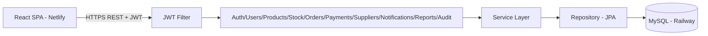

# REPORT 1: `PROJECT_SPEC.md`
## Inventory Flow — Software Engineering Progress Report

> **Status note:** This is a simulated business scenario created as a resume project. All requirements are the author's assumptions, not verified research findings. This document distinguishes confirmed decisions from assumptions and AI recommendations throughout.

### 1. Original Idea
A business application for managing products, warehouses, stock, suppliers and customer orders. Generic (not industry-specific), for single-company internal use.

### 2. Problem Statement (Confirmed)
A medium-sized company (3–5 warehouses, ~100 products, 30–50 orders/day) manages inventory and orders in a shared Google Sheet. Problems:
1. Order tracking is difficult; poor interface and no visualization.
2. No low-stock alerts — shortages discovered late.
3. Stock inconsistency across warehouses; risk of overselling.
4. Discovering stock unavailability takes a long time.

### 3. Research Completed
**None.** No real users interviewed, no business observed. All findings are simulated assumptions. (Author's decision: Option A — simulated scenario.)

### 4. Research Findings
Not applicable — no real research conducted.

### 5. Target Users
Admin, Warehouse Staff, Sales Staff.

### 6. Roles & Permissions (Confirmed)
| Role | Can | Cannot |
|------|-----|--------|
| **Admin** | Manage staff accounts; view all warehouses; approve registrations; manage product catalog & suppliers; send notifications; view all reports & audit log | — |
| **Warehouse Staff** | Manage orders, stock, payments for **own warehouse only**; view own stock/payment reports | Other warehouses; create products; send notifications |
| **Sales Staff** | Create orders (if stock available); generate payment slips; view availability across all warehouses; track orders; send feedback | Manage stock/staff; edit/reverse payments; view reports |

### 7. Business Rules (Confirmed)
- Staff self-register (select role + warehouse); Admin approves. Admin role not self-selectable.
- Only Admin creates products (global catalog).
- Warehouse Staff adjust stock for own warehouse only.
- Stock reservation happens **immediately** at order creation.
- Available stock = `quantity − reserved_quantity`.
- Payment lands directly in the warehouse's record — no warehouse confirmation.
- One order = one warehouse (split purchases = separate orders).
- Low-stock alerts → Warehouse Staff (own) + Admin; edge-triggered (fire on crossing threshold, reset when back above).
- Order cancellation allowed **before dispatch** only; Sales + Warehouse (own) + Admin; requires payment reversal if paid.
- Returns/refunds excluded from MVP.
- Suppliers: directory only (no product linking).
- Role permissions fixed in code (no runtime configuration).

### 8. Current Workflow (Simulated)
Customer contacts Sales → Sales writes order in Google Sheet → stock checked manually → Sales **calls** warehouse → warehouse picks/packs/dispatches → payment recorded in Sheet **and** Tally → delivery. Pain: phone dependency, no live stock, dual payment records, late stock discovery.

### 9. Proposed Workflow (Confirmed)
Customer contacts Sales → Sales checks real-time stock per warehouse → creates order → system routes to correct warehouse instantly → Sales generates payment slip (recorded directly) → warehouse sees order on dashboard, picks/packs/dispatches, updates status → Sales/Admin track status → system auto-alerts on low stock.

### 10. Functional Requirements (Confirmed)
| # | Requirement |
|---|-------------|
| 1 | Self-registration + Admin approval; JWT auth |
| 2 | Admin-managed global product catalog |
| 3 | Per-warehouse stock management with reserved_quantity |
| 4 | Search & filter for products and orders |
| 5 | Low-stock alerts (Warehouse own + Admin), edge-triggered |
| 6 | Manual notifications (Admin → all users or specific role) |
| 7 | Reports: sales, stock, payment (role-scoped) |
| 8 | Receipt uploads: JPG/PNG/PDF, 5 MB max |
| 9 | Audit log (Admin-only viewing), `details` as JSON column |
| 10 | Clear error messages; block invalid actions |
| 11 | Supplier directory (Admin-maintained, no product links) |
| 12 | Order cancellation before dispatch, audit-logged, payment reversal |
| 13 | Returns/refunds — excluded (future) |

**Deferred:** runtime permission management, per-category restrictions, supplier–product linking, per-warehouse thresholds, multi-warehouse orders, sockets.

### 11. Non-Functional Requirements (Confirmed)
Responses < ~1s at scale; paginated listings; transactional order creation; maintains ~50 orders/day; layered maintainable structure; consistent error responses; Railway logs; backup delegated to Railway (no custom strategy); minimal customer data retention.

### 12. Data Requirements — Entities
User, Role, Warehouse, Product, Stock, Order, OrderItem, Payment, Supplier, Notification, AuditLog.

### 13. Database Schema (Confirmed)

**Role:** id, name (Admin/Warehouse Staff/Sales Staff)

**Warehouse:** id, name, address, region, phone, created_at

**User:** id, name, email (unique, login), password_hash, role_id FK, warehouse_id FK (nullable; required for Warehouse Staff), status (pending/active/rejected), created_at

**Product:** id, name, sku, category, price, unit, low_stock_threshold (global), created_at

**Stock:** id, product_id FK, warehouse_id FK, quantity, reserved_quantity, updated_at — **unique (product_id, warehouse_id)**

**Order:** id, order_number, customer_name, customer_contact, created_by FK→User, warehouse_id FK, status, total_amount, created_at

**OrderItem:** id, order_id FK, product_id FK, quantity, unit_price (price snapshot), subtotal

**Payment:** id, order_id FK, amount, method (cash/bank transfer/card/other), status (paid/reversed), receipt_file_path, recorded_by FK, created_at

**Supplier:** id, name, contact_person, phone, email, address, created_at

**Notification:** id, recipient_id FK, title, message, type (manual/low_stock), created_by FK (nullable), read_at (nullable), created_at — one row per recipient

**AuditLog:** id, user_id FK, action, entity_type, entity_id, details (JSON), created_at

**Relationships:** Warehouse 1—N User; Product M—N Warehouse via Stock; Order N—1 Warehouse; Order N—1 User; Order 1—N OrderItem → N—1 Product; Order 1—N Payment; User 1—N Notification/AuditLog.

### 14. API Design (Confirmed) — 40 endpoints

| Group | Endpoints | Access |
|-------|-----------|--------|
| Auth (4) | POST /auth/register, /auth/login, /auth/logout; GET /auth/me | Public/Auth |
| Users (6) | GET /users/pending, /users; PATCH /users/{id}/approve, /reject, /users/{id}, /users/me | Admin (+own profile) |
| Products (4) | GET /products, /products/{id}; POST /products; PATCH /products/{id} | All read; Admin write |
| Stock (4) | GET /warehouses/{id}/stock, /stock/availability/{productId}, /stock/low; PATCH /warehouses/{id}/stock/{productId} | Scoped |
| Orders (5) | POST /orders; GET /orders, /orders/{id}; PATCH /orders/{id}/status; POST /orders/{id}/cancel | Scoped |
| Payments (4) | POST /orders/{id}/payments; GET /orders/{id}/payments; POST /payments/{id}/receipt, /payments/{id}/reverse | Sales/Admin; reverse Admin |
| Suppliers (5) | GET /suppliers, /suppliers/{id}; POST; PATCH; DELETE | Admin |
| Notifications (4) | GET /notifications; PATCH /notifications/{id}/read, /notifications/read-all; POST /notifications/send | Own; send Admin |
| Reports (3) | GET /reports/sales, /reports/stock, /reports/payments | Admin all; Warehouse own |
| Audit (1) | GET /audit-logs | Admin |

### 15. Technology Decisions (Confirmed)
| Item | Choice | Reason |
|------|--------|--------|
| Backend | Java + Spring Boot | Existing skill |
| Database | MySQL | Known; JSON support adequate for audit details |
| Frontend | Vite + React + Material UI + React Router | Known skill; MUI speeds up data-heavy UI |
| Auth | JWT | Natural fit for SPA + separate backend |
| Deployment | Netlify (FE) + Railway (BE + MySQL) | Platforms known to author; free tier |

### 16. System Architecture (Confirmed)
Client–server SPA + **modular monolith** (no microservices justified). Backend layers: Controller → Service → Repository → Entity. Cross-cutting: JWT security filter, global exception handler, audit interceptor. Client never touches DB directly; authorization enforced server-side.

### 17. UI/UX (Confirmed)
~23 screens. Persistent layout: top bar (name, notification bell, user menu) + role-based left sidebar. Key journeys: order creation (atomic stock reservation), order fulfillment (confirmed→dispatched→delivered, cancel before dispatch), low-stock edge-triggered alerting.

### 18. Security Requirements (Confirmed)
BCrypt password hashing; JWT with expiry; server-side role + ownership authorization; input validation; file type/size validation server-side, stored outside web root; HTTPS; parameterized queries (JPA); Admin not self-selectable; login rate limiting.

### 19. MVP Scope (Confirmed)
**Must:** auth, products, stock, orders, payments, alerts, manual notifications, reports, audit, suppliers, RBAC.
**Should:** notification read tracking, search polish, dashboard charts.
**Could:** supplier–product linking, per-warehouse thresholds.
**Won't:** returns/refunds, runtime permissions, multi-warehouse orders, sockets.

### 20. Development Roadmap (Confirmed)
1 Foundation → 2 Auth → 3 Users → 4 Products → 5 Stock → 6 Orders → 7 Payments → 8 Notifications → 9 Reports → 10 Suppliers → 11 Audit → 12 Deployment.
Each module cycle: DB → API → logic → frontend → tests.

### 21. Testing Requirements (Confirmed)
JUnit + Mockito unit tests (learned incrementally), Spring Boot integration/API tests incl. role authorization, edge cases (insufficient stock, duplicate email, double cancel, oversized file, expired JWT), light React Testing Library, manual end-to-end of three key journeys.

### 22. Deployment Plan (Confirmed)
Netlify (frontend), Railway (backend + MySQL plugin). Secrets as env vars, never in GitHub. Auto-deploy on push to `main`. Migrations on startup. Railway logs. Backend sleep on free tier accepted.

### 23. Confirmed Decisions
All items in sections 6, 7, 10–22 above.

### 24. Assumptions (Unverified)
Entire business scenario is simulated: company size, pain points, current workflow, Google Sheets + Tally usage, staff behavior. No supplier participation. No real customer data.

### 25. Unanswered Questions
- Exact status-transition matrix for orders (proposed: pending→confirmed→dispatched→delivered; cancel before dispatch).
- Whether low-stock threshold reset logic needs an explicit flag column (design detail).
- UI helper for splitting multi-warehouse purchases (noted, not specified).

### 26. Recommended Next Steps
Finalize status-transition rules → build Module 1 (foundation) → proceed through roadmap → write tests per module → deploy → keep `INTERVIEW_REPORT.md` updated at each milestone.
